<p align="center">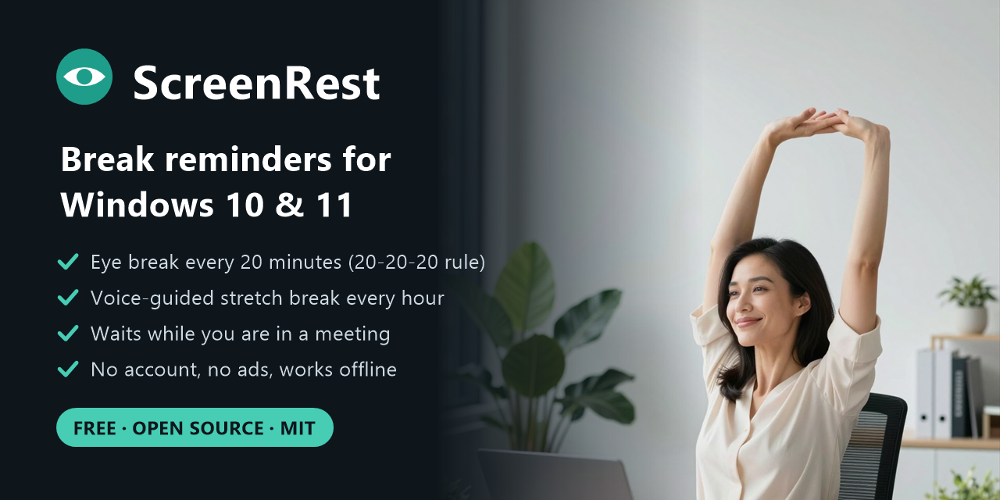</p>

# ScreenRest

A free, open-source break coach for **Windows and macOS** that covers your work shift (8:00–17:00 by default). It lives in the Windows system tray or the Mac menu bar. It makes you rest your eyes with the 20-20-20 rule and stand up to move every hour, with voice-guided exercises for blood flow and posture.

| | Windows | macOS |
|---|---|---|
| Runs on | Windows 10 and 11 (.NET Framework 4.x, built in) | macOS 13 Ventura and later, Apple silicon and Intel |
| Download | `ScreenRest-Setup-x.y.z.exe` installer, or portable zip | `ScreenRest-x.y.z-mac.dmg`, or zip |
| Lives in | System tray, near the clock | Menu bar, top right |
| Source | [`src/`](src/) (C#, WinForms) | [`mac/`](mac/README.md) (Swift, AppKit) |

No internet, no account, no ads. English and Tagalog. Both versions have the same breaks, exercises, videos, voice-overs and stats, and use the same settings and history file format.

**[🌐 Website: screenrest.jilbert.net](https://screenrest.jilbert.net/)** · **[⬇ Get the latest release](https://github.com/jsmejia27/ScreenRest/releases/latest)**

> The downloads aren't code-signed or notarized yet.
> - **Windows:** SmartScreen may say *"Windows protected your PC"*. Click **More info → Run anyway**.
> - **Mac:** macOS may say ScreenRest *"can't be opened"* or can't be checked for malware. Click **Done**, then go to **System Settings → Privacy & Security** and click **Open Anyway**. You only do this once. On macOS 13 and 14, Control-click → **Open** also works.
>
> Check the SHA-256 against `SHA256SUMS.txt` on the release, or [build it yourself](#6-building-from-source).

## Screenshots

| Eye break | Stretch break |
|---|---|
| 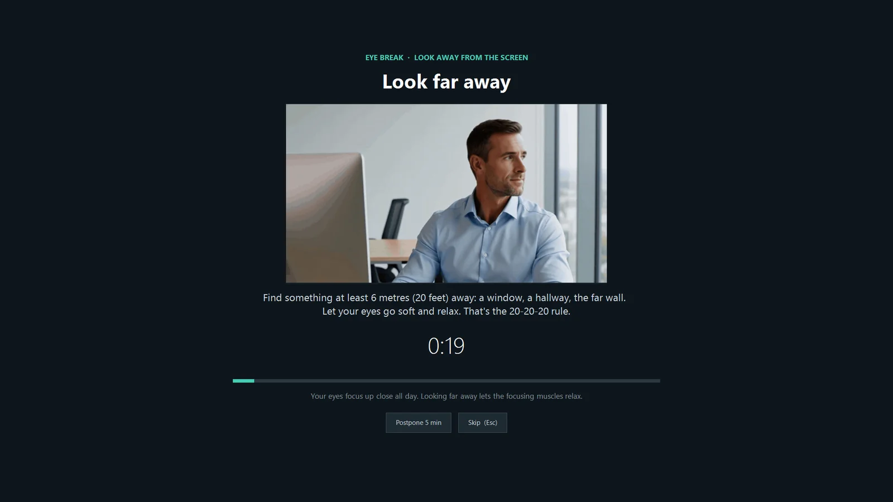 | 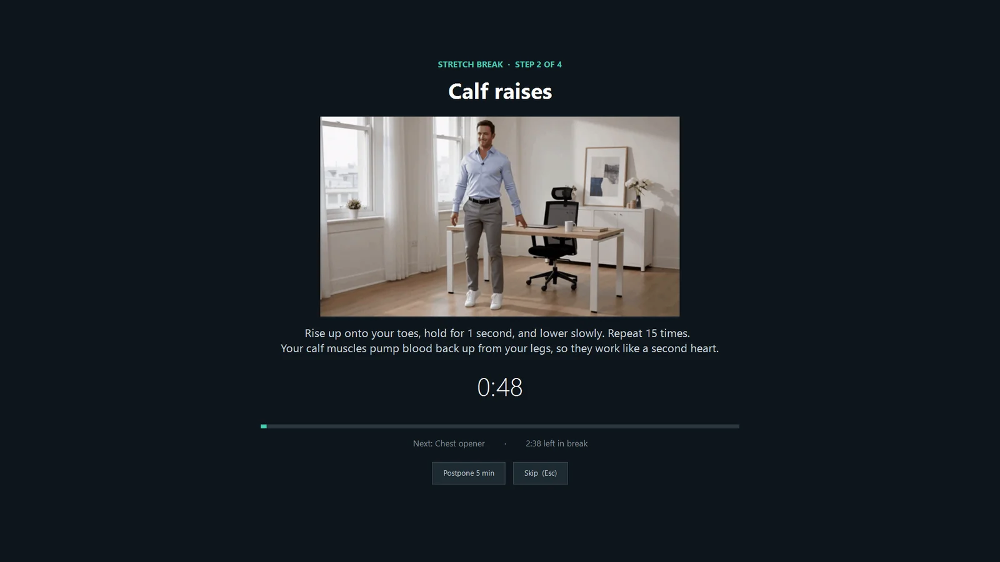 |
| **Settings** | **Dashboard** |
| 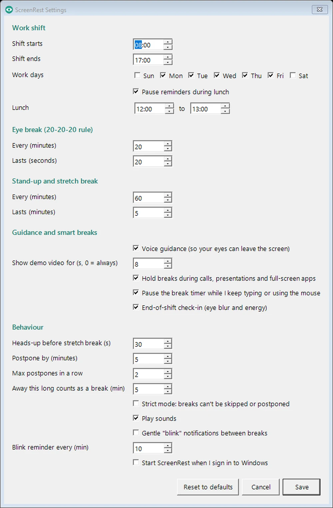 | 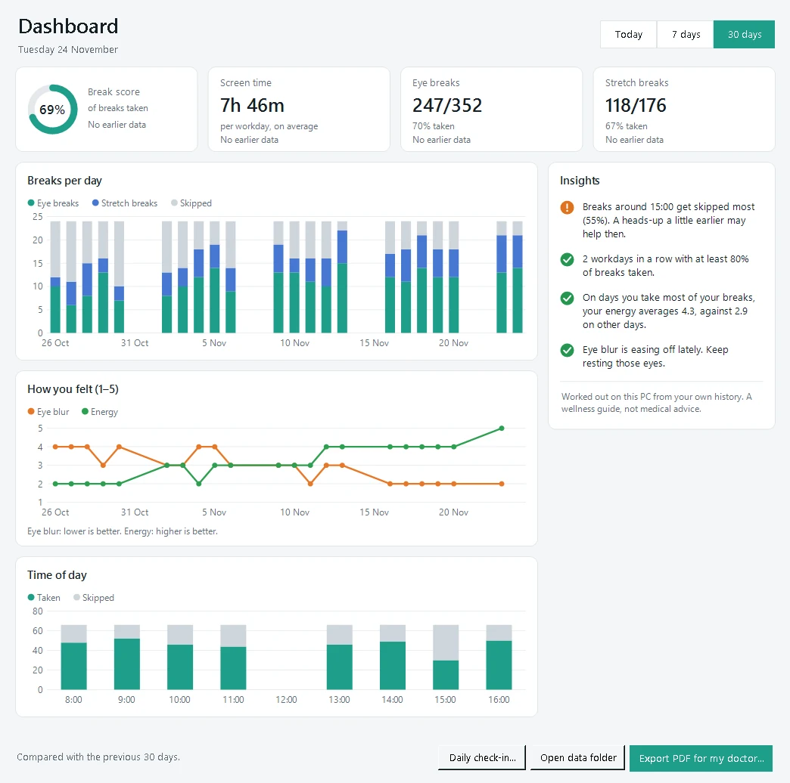 |

**macOS**

| Dashboard | Stretch break |
|---|---|
| 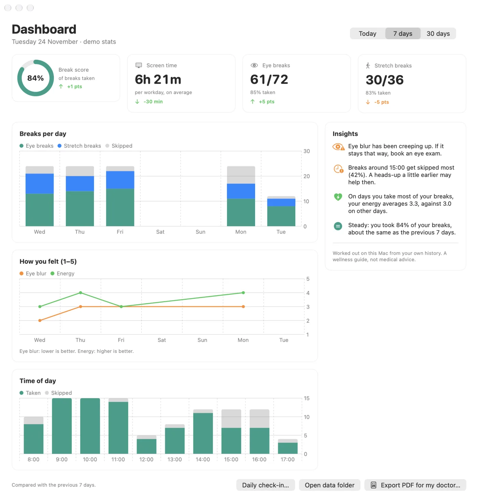 | 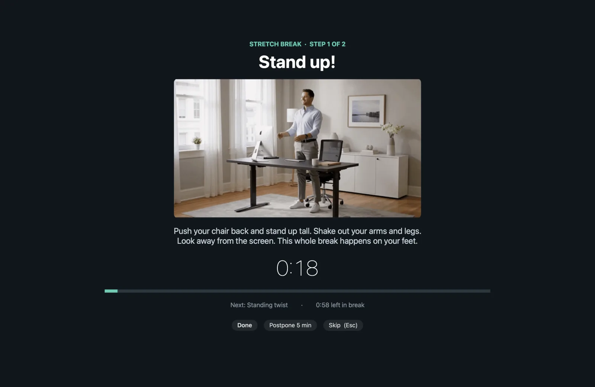 |
| **PDF for your eye doctor** | **Settings** |
| 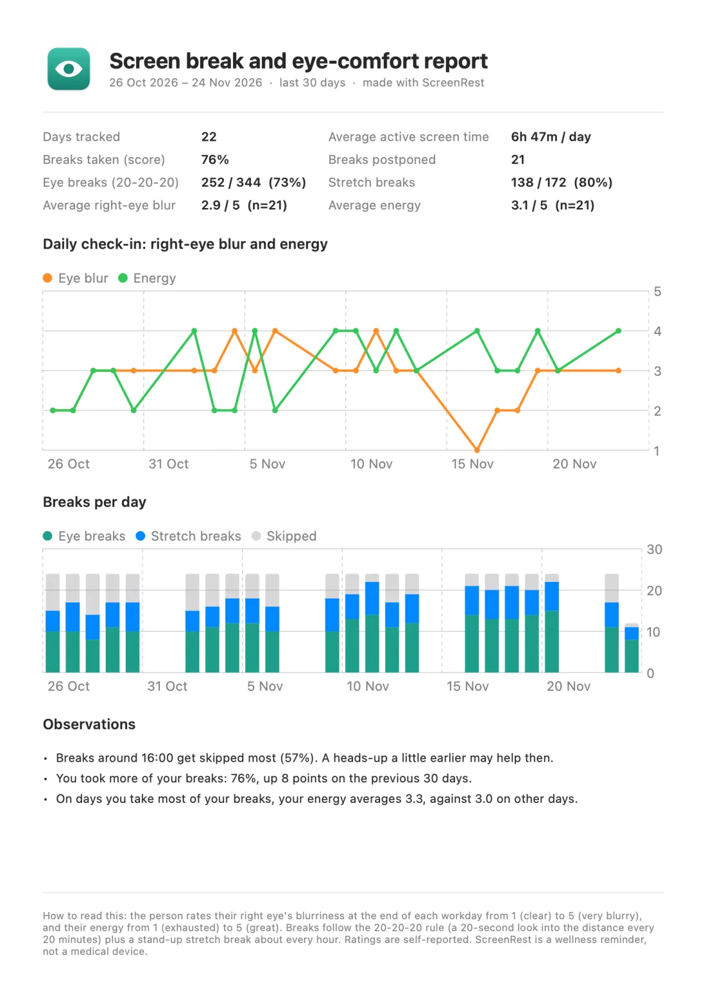 | 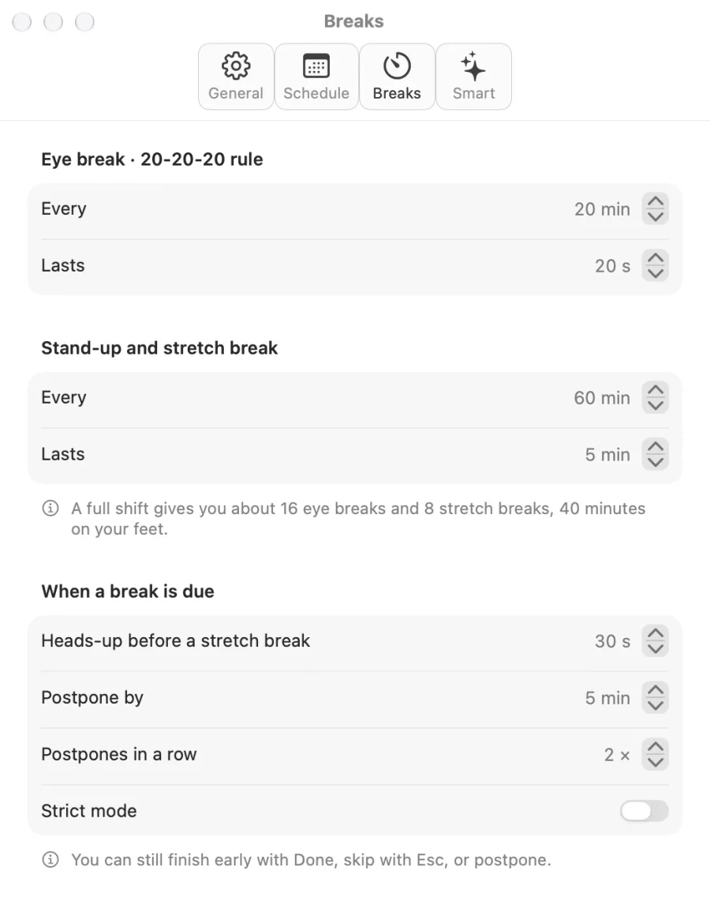 |

<details>
<summary>Promo carousel (Tagalog, 1080×1350)</summary>

<p>

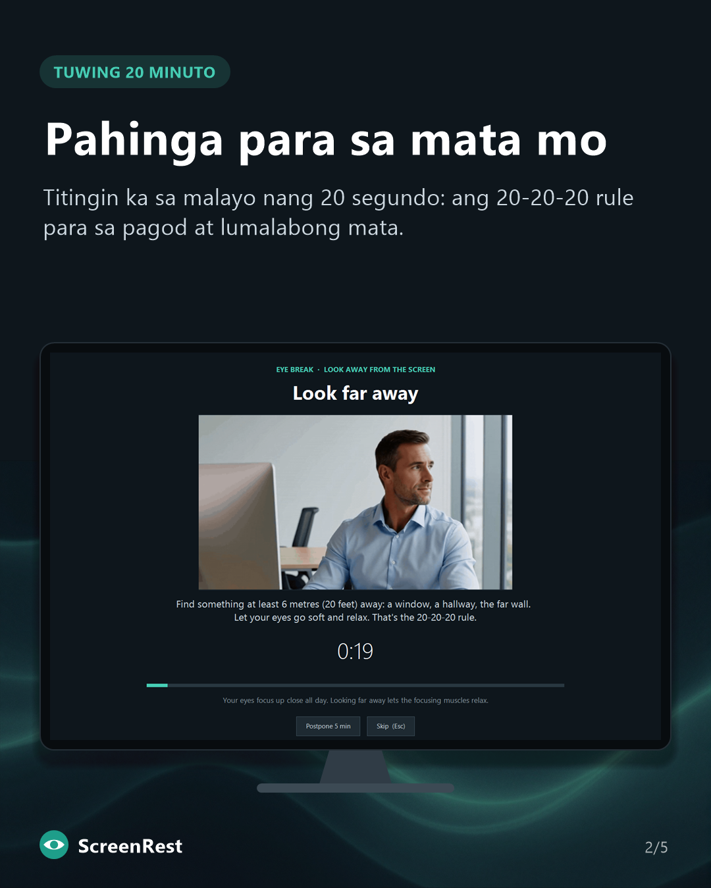
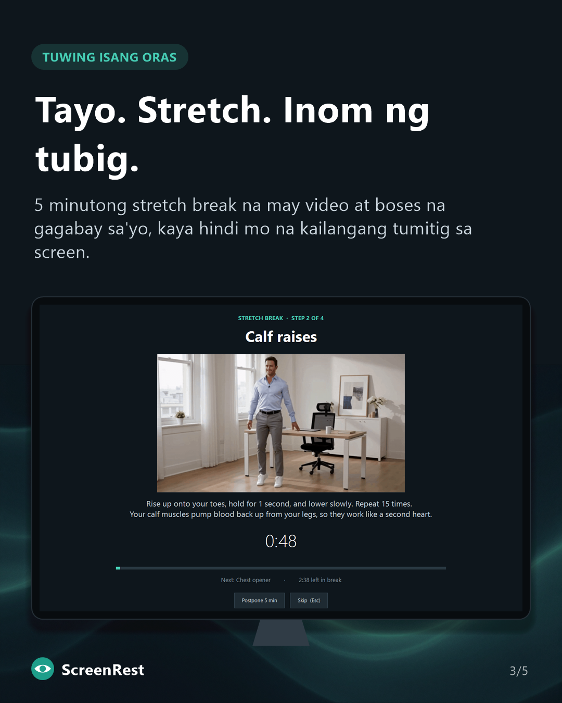
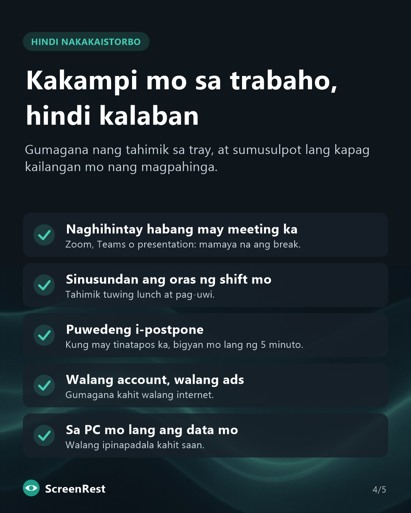
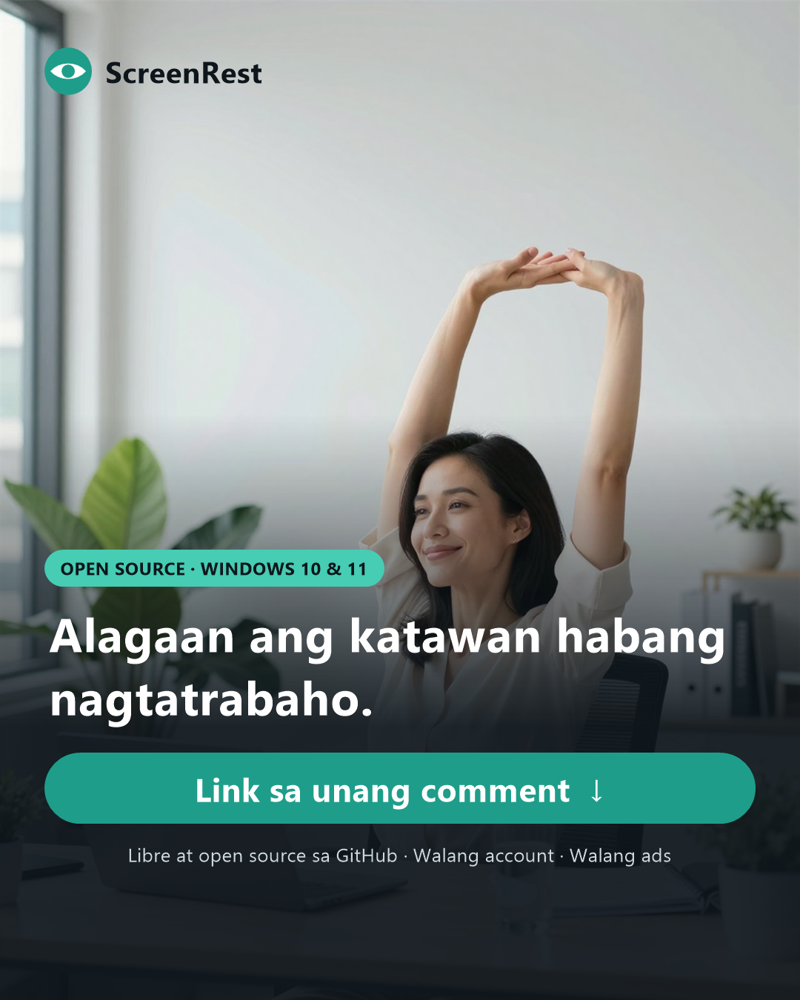
</p>

The images are generated by `marketing\make_facebook.ps1`, which also writes `docs\images\banner.png`.
</details>

---

## 1. Existing Windows apps compared

| | **Workrave** | **Stretchly** | **EyeLeo** | **BreakTimer** | **Big Stretch Reminder** | **ScreenRest** |
|---|---|---|---|---|---|---|
| Price / source | Free, open source | Free, open source | Free (Windows only) | Free, open source | Free | Free, open source (MIT) |
| Short eye breaks (20-20-20) | ✅ micro-pauses | ✅ mini breaks | ✅ **eye exercises, its focus** | ⚠️ generic breaks | ⚠️ generic | ✅ 6 rotating eye exercises |
| Guided stretches / exercises | ✅ illustrated exercises | ⚠️ text "ideas" | ⚠️ eye only | ❌ custom text | ❌ custom text | ✅ 14 step-by-step routines with video, voice and timers |
| Full-screen dim during breaks | ✅ | ✅ | ✅ | ✅ (optional) | ⚠️ popup | ✅ all monitors |
| Strict mode (can't skip) | ✅ | ✅ | ✅ | ⚠️ | ❌ | ✅ |
| Postpone, with a limit | ✅ | ✅ | ⚠️ | ✅ | ✅ | ✅ (default max 2 in a row) |
| Natural break / idle detection | ✅ **best in class** | ✅ | ⚠️ | ✅ idle reset | ❌ | ✅ |
| Working-hours schedule | ❌ | ⚠️ pause only | ❌ | ✅ **working hours** | ❌ | ✅ shift, work days and lunch |
| Pre-break heads-up | ✅ | ✅ | ✅ | ✅ | ❌ | ✅ |
| Daily statistics | ✅ **detailed** | ❌ | ❌ | ❌ | ❌ | ✅ daily score and 7-day history |
| Pause for meetings | ✅ | ✅ | ✅ | ✅ | ⚠️ | ✅ automatic, plus 30 min, 1 h, 2 h, rest of day |
| Ease of setup | Medium (many options) | Easy | Easy | Easy | Very easy | Very easy (good defaults) |

✅ = yes · ⚠️ = partial or basic · ❌ = no. Feature details come from the vendors' descriptions and public roundups, so check the current version before relying on them.

### Strongest feature of each, all included in ScreenRest

| From | Feature borrowed |
|---|---|
| **Workrave** | Natural-break detection: if you walk away for 5+ minutes, the timers reset. Plus daily statistics. |
| **Stretchly** | Two break tiers (short and long), full-screen dim, strict mode, pause menu, multi-monitor. |
| **EyeLeo** | Eye-exercise content (palming, near-far focus, blinking, eye circles) with pre-break warnings. |
| **BreakTimer** | Working-hours schedule. ScreenRest only runs during your shift and stays quiet at lunch and on weekends. |
| **Big Stretch** | Simplicity. Sensible defaults, so it works the moment you launch it. |
| **ScreenRest extras** | Blood-flow routines that run step by step (calf raises, squats, marching, hip flexors), a body cue during every eye break, a hydration step, a morning greeting and an end-of-shift summary. |

---

## 2. How your day looks with the default settings

| Time | What happens |
|---|---|
| 08:00 | "Good morning" notification. Tracking starts. |
| Every 20 min | **Eye break, 20 s.** Screen dims and you do one eye exercise plus a quick posture cue. |
| Every 60 min | **Stretch break, 5 min.** Stand up, then 4–5 guided moves (about 50 s each), then walk and drink water. A heads-up comes 30 s before. |
| 12:00–13:00 | Lunch. No reminders. |
| Away 5+ min | Counts as a break. Timers reset automatically. |
| 17:00 | End-of-shift summary (breaks taken, score). Reminders stop. |

Over a full day that comes to about **20 eye breaks and 7 stretch breaks**.

---

## 3. Using it

1. **Windows:** run the installer (or unzip the portable build and double-click **`ScreenRest.exe`**). A teal eye icon appears in the system tray near the clock. You may need to click **^** to see it.
   **Mac:** open the `.dmg`, drag ScreenRest into Applications and open it (see the note above the first time). A teal eye icon appears in the menu bar.
2. Right-click the icon on Windows, or click it on a Mac:
   - **Take an eye break / stretch break now**
   - **Pause reminders** for a meeting or presentation (30 min, 1 h, 2 h, rest of today)
   - **Dashboard...**: today, the last 7 or 30 days, insights and a PDF for your eye doctor. On Windows, double-clicking the icon opens it too.
   - **Settings...** to change shift hours, intervals, strict mode, sounds and blink nudges
   - Tick **Start ScreenRest when I sign in to Windows** (Mac: **Open ScreenRest when I log in to my Mac**) in Settings so it covers every shift automatically.
3. During a break: **Esc** skips and **Postpone 5 min** delays. Both disappear in strict mode.

**Try it in 2 minutes:** `ScreenRest.exe --demo` on Windows, or `open /Applications/ScreenRest.app --args --demo` on a Mac (eye break every 30 s, stretch every 90 s, ignores shift hours).

Icon colours: **teal** = tracking, **grey** = paused or off shift, **orange** = on a break.

**Language:** English or Tagalog, picked on the welcome screen or in Settings → *Language / Wika*. All screens, exercises and summaries switch; the voice-overs stay in English.

Files are kept in `%APPDATA%\ScreenRest\` on Windows and `~/Library/Application Support/ScreenRest/` on a Mac: `settings.ini`, `stats.csv` (one row per day, including your check-in ratings; opens in Excel or Numbers) and `breaks.csv` (one row per break, with its time and whether you took it). The format is the same on both, so you can copy your history across. Nothing leaves your computer.

## 4. Smart features

| Feature | What it does | Setting |
|---|---|---|
| **Voice guidance** | Each step is read aloud by a calm voice. On Windows the demo video plays for the first 8 s, then dims ("Eyes off the screen. Follow the voice."); press **V** to see it again. On a Mac the video stays on for the whole step. | *Voice guidance*, *Show demo video for* (Windows) |
| **Meeting-aware** | If your camera or mic is in use (Teams, Zoom, Meet), you're presenting, or a full-screen app is in front, the break waits and starts 10 s after you're free. The tray says "Break on hold". | *Hold breaks during calls...* |
| **Hands-off check** | If you keep typing or using the mouse during a break, the countdown pauses with an orange nudge. A break only counts when you actually take it. | *Pause the break timer...* |
| **Daily check-in** | At the end of the shift, rate eye blur and energy from 1 to 5. Also in the tray menu. | *End-of-shift check-in* |
| **Dashboard** | Today, 7 or 30 days at a glance: break score, screen time, eye and stretch breaks compared with the period before, charts of breaks per day, check-in ratings and the time of day you take or skip breaks, and up to four short insights from your own history. It opens on the last 7 days after the check-in on your last work day (Friday). | |
| **PDF for your eye doctor** | Dashboard → *Export PDF*: one A4 page with 30 days of breaks, screen time and eye-blur and energy ratings, and a note on how to read them. | |
| **Countdown on the icon** | Optional: the tray (Windows) or menu bar (Mac) icon shows the minutes to your next break. | *Show minutes to the next break...* |
| **Calendar** (Mac) | Optional: breaks wait during meetings in your calendar, and a stretch break due during one moves to just before it. | *Use my calendar* |

Demo mode (`--demo`) keeps its own `stats-demo.csv` and `breaks-demo.csv`, so test runs never touch your real history.

## 5. Exercise videos and voice-overs

Every exercise (6 eye, 14 stretch) has a looping demo clip and a spoken voice-over, generated locally with ComfyUI. Missing files are fine: that step falls back to text and a chime.

- The app plays `media\<slug>.gif` and `media\<slug>.wav` next to `ScreenRest.exe`, for example `media\calf_raises.gif`. The slug is the exercise title in lowercase with `_` between words.
- **Video:** MiniMax H3 Text to Video (8-step turbo LoRA, about 5 s at 864×480), one fixed seed and the same character and office description so the clips look like a single series. Base workflow: `comfy\minimax_t2v.json`.
- **Voice:** Chatterbox Multilingual, cloning a reference voice. The spoken text comes straight from the app's instructions, so audio always matches the screen.

```powershell
powershell -ExecutionPolicy Bypass -File .\comfy\make_voice.ps1 -Submit
```

```powershell
powershell -ExecutionPolicy Bypass -File .\comfy\make_media.ps1
```

`make_voice.ps1 -Submit` (re)queues voice-overs. Add `-VoiceSample <file in ComfyUI\input>` to clone another voice, `-Seed 11` to re-roll a take, or `-Only palming,calf_raises` to redo a few. `make_media.ps1` converts everything ComfyUI rendered into `media\`, keeping the newest render per exercise.

## 6. Building from source

### Windows

Uses `csc.exe` from .NET Framework 4.x, which is already on every Windows 10/11 PC. No Visual Studio needed.

```powershell
powershell -ExecutionPolicy Bypass -File .\build.ps1
```

To package a release (after `build.ps1`):

```powershell
powershell -ExecutionPolicy Bypass -File .\installer\build_setup.ps1
```

This writes `dist\ScreenRest-Setup-<version>.exe` (one-file per-user installer: Start menu shortcut, optional startup and desktop shortcut, entry in Windows Settings > Apps; uninstall runs `ScreenRest.exe --uninstall`) and `dist\ScreenRest-<version>-portable.zip`, and prints SHA-256 checksums. Set `$env:VERSION = '1.2.0'` first to build a different version number without editing the source; CI does this from the `v*` tag. Releases are published on the [Releases page](https://github.com/jsmejia27/ScreenRest/releases).

### macOS

Needs only the Xcode Command Line Tools (`xcode-select --install`), no Xcode project:

```bash
./mac/build.sh --package
```

This writes `mac/build/ScreenRest.app` (universal: Apple silicon and Intel) and `dist/ScreenRest-<version>-mac.dmg` and `.zip`, and prints SHA-256 checksums. The GitHub Actions workflow builds the Mac files on a Mac runner too, and a `v*` tag publishes them in the same release as the Windows files. See [mac/README.md](mac/README.md) for how each Windows feature maps to macOS and a list of the Swift source files.

### Windows source files

| File | Purpose |
|---|---|
| `src\Program.cs` | Entry point, single-instance guard, `--demo` flag |
| `src\TrayApp.cs` | Tray icon, menu, shift schedule, timers, idle detection |
| `src\BreakForm.cs` | Full-screen guided break: video, voice, hands-off check, dim overlay for other monitors |
| `src\Native.cs` | Idle time, and call/presentation/full-screen detection |
| `src\HealthForms.cs` | Daily check-in |
| `src\Dashboard.cs` | Dashboard window: summary cards, charts and insights (same rules as the Mac app) |
| `src\ReportPdf.cs` | One-page PDF for your eye doctor, written without any PDF library |
| `src\BreakLog.cs` | `breaks.csv`: time, type and result of every break (feeds the time-of-day chart and insight) |
| `src\AppForms.cs` | First-run welcome and About windows |
| `src\Uninstaller.cs` | `--uninstall`: removes shortcuts, startup and Apps entries, optionally your data |
| `src\AssemblyInfo.cs` | Version, product info and copyright |
| `src\Lang.cs` | English / Tagalog switch: every UI string is written as `L.T("English", "Tagalog")` |
| `src\Exercises.cs` | Eye and body exercise library, routine builder |
| `src\Settings.cs` / `SettingsForm.cs` | Settings model and window |
| `src\Stats.cs` | Daily statistics and check-in ratings (`stats.csv`) |
| `mac\` | The macOS version (Swift / AppKit): sources, `Info.plist`, `build.sh` |
| `src\IconFactory.cs` | Draws the app icon in code |
| `installer\` | Setup program and release packaging script |
| `store\` | Microsoft Store package: manifest, `build_msix.ps1`, listing text and screenshots |
| `.github\workflows\build.yml` | Builds everything on GitHub, signs it with SignPath, publishes releases on `v*` tags |
| `website\` | Static download site (`index.html`, `assets\`) |

### Signing and the Microsoft Store

- **Signed downloads (SignPath, free for open source):** GitHub Actions builds the app from this repository and sends it to SignPath for signing. See [CODE_SIGNING.md](CODE_SIGNING.md) for the policy and setup. Until SignPath approves the project, the workflow still builds everything, just unsigned.
- **Microsoft Store:** `store\build_msix.ps1` makes `dist\ScreenRest-<version>.msix`. Microsoft signs it when it's published. Pass the three Product identity values from Partner Center (or set the repo variables `STORE_IDENTITY_NAME` and `STORE_PUBLISHER` so the GitHub build uses them). Listing text in English and Filipino is in [store/LISTING.md](store/LISTING.md). The Store version starts with Windows through the manifest's startup task, which users manage in Windows Settings > Apps > Startup.

```powershell
powershell -ExecutionPolicy Bypass -File .\store\build_msix.ps1 -IdentityName "<Package/Identity/Name>" -Publisher "<Package/Identity/Publisher>"
```

## 7. Website

The project site is live at **[screenrest.jilbert.net](https://screenrest.jilbert.net/)**: features, exercise previews, screenshots, FAQ and download buttons that point to the files on this repo's [Releases page](https://github.com/jsmejia27/ScreenRest/releases).

It's a static, dependency-free page in `website\` (`index.html` plus `assets\`), served by a small read-only Cloudflare Worker from an R2 bucket. To preview it locally:

```powershell
python -m http.server 8765 --directory .\website
```

---

## Not medical advice

ScreenRest is a wellness reminder that helps you build healthy screen habits. It doesn't replace a check-up: if your vision stays blurry, or you have pain or constant tiredness, see an optometrist or doctor.

## License

[MIT](LICENSE) © 2026 Jilbert Mejia
